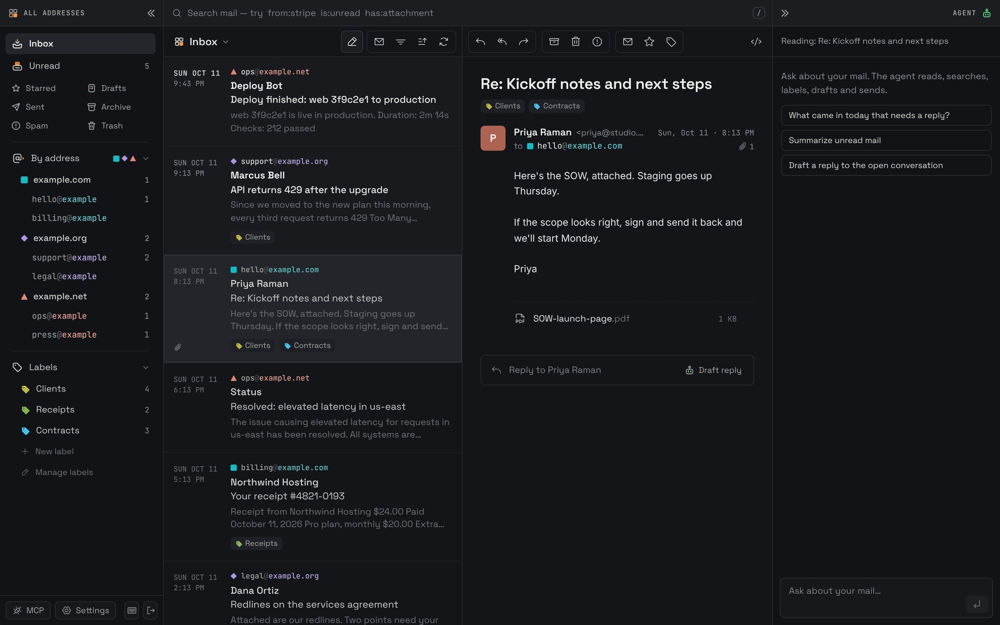
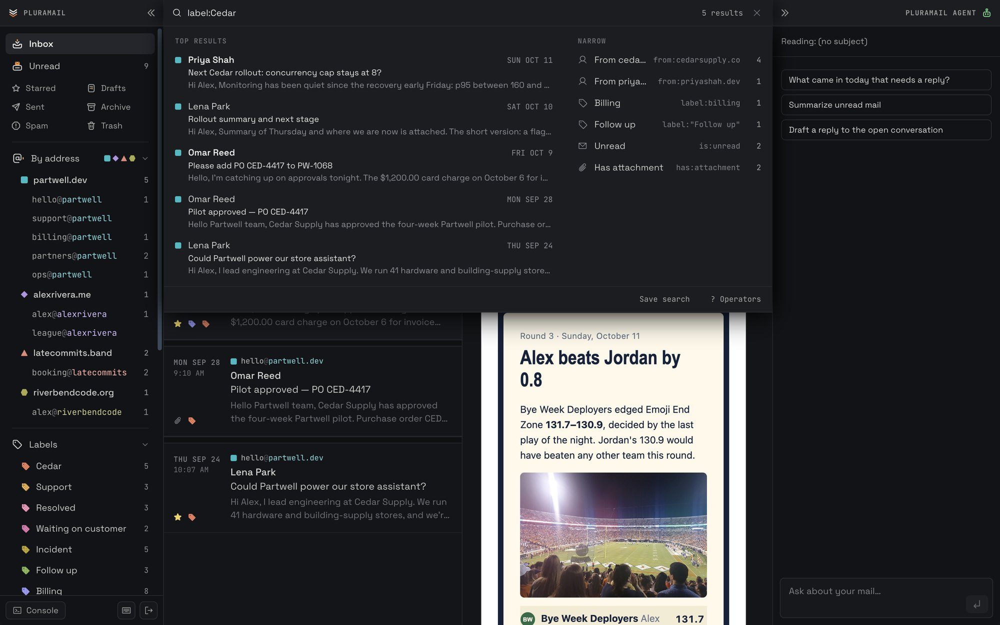
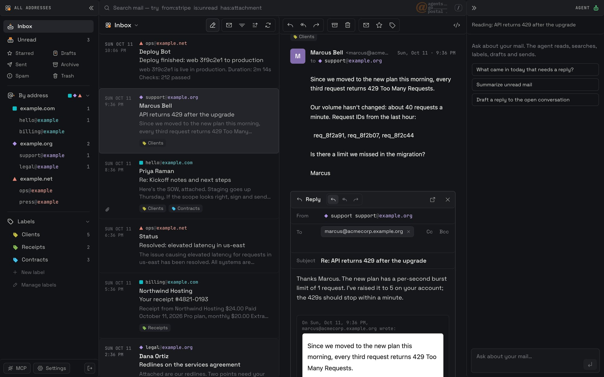
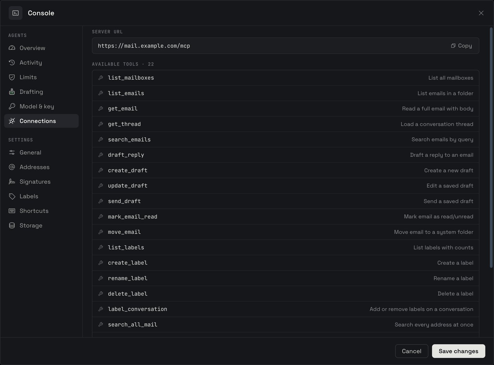
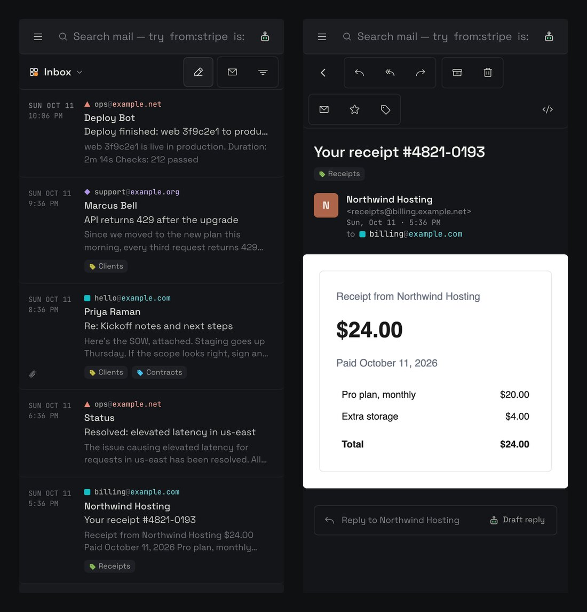

<h1>
  <picture>
    <source media="(prefers-color-scheme: dark)" srcset="public/brand/logo-stacked-dark.svg">
    
  </picture>
</h1>

**An email UI for Cloudflare Email Routing/Service.**

Every message to your domain arrives in a Worker you deploy, and Email Service sends replies from the same Worker with SPF, DKIM and DMARC already in place.

Cloudflare doesn't include a mail client. Agents Go Postal is one: every address on every domain in one list, on desktop or phone, with an agent that can search, label, draft and send. It runs entirely on your Cloudflare account.

> **Work in progress.** It runs on real mail daily and changes often. Pin a commit if you deploy it, and see the [roadmap](#roadmap).

[](https://deploy.workers.cloudflare.com/?url=https://github.com/johnnywon/agents-go-postal)
[](LICENSE)
[](https://developers.cloudflare.com/workers/)



## What you can run on it

- **A startup with several arms.** The company domain, the product domain and the docs domain each have `sales@`, `support@`, `billing@` and `press@`. All of it lands in one list. The agent drafts support replies and files invoices, and every reply leaves from the address that received the mail.
- **A consultant or agency with mail per client.** Each engagement gets an address on its own domain. One inbox, a label per client, and `to:` narrows the list to one client.
- **An indie developer with a shelf of side projects.** `hello@`, `abuse@` and app store contact addresses for ten small products, without ten mailbox plans or forwarding everything to a personal account.
- **Agents that need their own address.** Give a support agent `support@` and a finance agent `receipts@`. They read, label and draft through MCP. You see every message and every draft in the same list.
- **Finance and ops across several companies.** Invoices, receipts and alerts from every entity in one place. With attachment search on, `INV-2207` finds the invoice even when the number only appears inside the PDF.

## Product tour

### 1. Search every address at once



Operators, phrases, exclusions and `OR`, with results ranked by relevance and filters that narrow them as you type. A plain request like "unread newsletters this week" becomes a search you can see and edit.

**For developers:** one parser ([`shared/search-query.ts`](shared/search-query.ts)) compiles to one full-text query. The same string works in the URL (`?search=`), in the agent's `search_all_mail` and in every MCP search tool. Test a query in the UI, then hand it to an agent unchanged.

### 2. Reply from the right address



Replies go out from the address the message reached, with the original quoted. Drafts the agent writes open in the same composer, so you review and send.

**For developers:** sends go through Cloudflare's `send_email` binding. Each send carries an idempotency key, and a saved draft always sends with `draft:<id>`, so a draft goes out once whether a person, the agent or the scheduler sends it.

### 3. Plug in any agent over MCP

<p align="center"></p>

The MCP panel gives you the server URL and lists every tool: read, search, draft, send, label and move, across every address.

**For developers:** 19 tools over the same store the UI uses, behind the same Cloudflare Access login. Point Claude Code, Cursor or your own agent at `/mcp`. `search_all_mail` and `label_matching` act on every address in one call.

### Also in the box

An agent panel inside the app that searches, labels, drafts and sends when you ask, on Workers AI or any OpenRouter model with your key. Drafts, attachments, stars, archive, bulk actions with undo, scheduled send, signatures, keyboard shortcuts and a phone layout. The Worker refuses every request until Cloudflare Access is set up, and incoming HTML is sanitised, sandboxed and shown without remote images until you ask.

## How it works

```text
   Sender           You, in a browser    Claude Code, Cursor,   Cron, every
     |                    |              other MCP clients      minute
     v                    v                    |                  |
+---------------+  +-----------------+         | /mcp             | scheduled
| Email Routing |  | Cloudflare      |         |                  | sends,
+---------------+  | Access          |         |                  | attachment
     | email()     +-----------------+         |                  | text
     v                    v                    v                  v
+----------------------------------------------------------------------+
|                Worker: Hono API + React Router UI                    |
+----------------------------------------------------------------------+
     |                 |                  |                    |
     v                 v                  v                    v
+-------------+  +-------------+  +----------------+  +---------------+
| Mail store  |  | R2          |  | Agent          |  | Email Service |
| D1, or one  |  | attachments,|  | Durable Object |  | send_email    |
| DO per      |  | large bodies|  +----------------+  +---------------+
| address     |  +-------------+          |                    |
| + an index  |                           v                    v
+-------------+                   Workers AI or            Recipient
                                  OpenRouter
```

Everything runs in one Worker on your account. Mail is stored either in D1 (one database for every address) or in a Durable Object per address with a combined index. D1 is where the project is heading; see the roadmap.

What happens when a message arrives:

```text
Sender
  |  message to hello@example.com
  v
Email Routing
  |  email() event
  v
Worker
  1. Parse it. Mail to an address that isn't configured is dropped.
  2. Attachments ---------------------------------> R2
  3. The message, threaded into its conversation --> Mail store
  4. With AUTO_DRAFT_ENABLED, ask for a reply -----> Agent
     (skips mailing lists and no-reply senders)
  |
  v
It appears in the one list, under its address.
```

What happens when you send:

```text
You, the in-app agent, or an MCP client
  |  send as billing@example.com
  v
Worker
  1. Claim the send key, so a retried request can't send twice.
  2. Check the From address is the mailbox's own address.
  3. Thread it onto the conversation it replies to.
  4. send_email ---------> Email Service ---------> Recipient
                           (SPF, DKIM and DMARC
                            on your domain)
  5. Attachments --------> R2
  6. The Sent copy ------> Mail store
```

A scheduled send waits in the store; the cron runs these same steps when its time comes.

## Quick start

Requirements: a domain on Cloudflare, the Workers Paid plan (for sending) and R2.

1. Click **Deploy to Cloudflare** above. It copies the repo to your GitHub, creates the storage and deploys.
2. Set your addresses in `wrangler.jsonc` (`DOMAINS`, `EMAIL_ADDRESSES`) and push.
3. Turn on Cloudflare Access for the Worker and save its two values as secrets.
4. Route each address to the Worker with Email Routing, and enable Email Sending.

Each step, with commands, is in [docs/setup.md](docs/setup.md). To run it locally with sample mail, see [docs/development.md](docs/development.md).

<p align="center"></p>

## Roadmap

Shipped: one list for every address, labels and bulk actions with undo, scheduled send, the in-app agent, the MCP server, one search language, D1 storage with ranked and attachment search, Move to Inbox and Empty Trash.

These are the directions under consideration. [Open an issue](https://github.com/johnnywon/agents-go-postal/issues) to argue for one or propose another.

### Now: make it easy to run

- [ ] **One-command setup.** A CLI that creates the Email Routing rule for each address, enables Email Sending, turns on Access and writes the secrets. Setting up a new address becomes one command.
- [ ] **D1 as the only store.** Finish the migration and remove the Durable Object mail path, so there is one storage model to learn and test.
- [ ] **CI on every pull request.** Run tests, typecheck and build in GitHub Actions, plus a browser smoke test against a seeded dev server.
- [ ] **Import existing mail.** Bring in an mbox or IMAP export so a new deployment starts with history.

### Next: control over what agents do

- [ ] **Approval queue.** Agent sends and bulk changes can wait for one-click approval, with a log of every action an agent took and why.
- [ ] **Scoped access for agents.** MCP tokens limited to chosen addresses, read-only or draft-only, so a support agent never sees billing mail.
- [ ] **Rules in plain words.** "File receipts under Receipts" or "draft replies for support@" runs on each new message, shown as a readable rule you can edit.
- [ ] **Events for other Workers.** Publish new-mail and label events to Cloudflare Queues, so your own code can react without polling.

### Later: teams, search and offline

- [ ] **Per-person access.** People see only the addresses they are given, with assignment and internal notes for shared inboxes.
- [ ] **Search by meaning.** Opt-in Vectorize search alongside full-text, for "the email where they offered a discount".
- [ ] **Notifications and offline.** Web push for new mail and an installable app that reads cached mail offline.
- [ ] **Delete one message forever** from Trash, alongside Empty Trash.

## Docs

| | |
|---|---|
| [Setup](docs/setup.md) | Deploy, Access, Email Routing and Sending, configuration, moving to D1 |
| [Guide](docs/guide.md) | Every feature, keyboard shortcuts, the search language, the agent model |
| [Development](docs/development.md) | Local dev with sample mail, tests and checks |
| [Design](DESIGN.md) | The design system the UI follows |

## Contributing

Issues and pull requests are welcome. Before you open a PR:

```sh
npm test
npm run typecheck
npm run build
```

Keep changes small and focused. UI changes follow [DESIGN.md](DESIGN.md), and `tests/design-rules.test.mjs` checks the rules it can. Use `example.com`, `example.org` and `example.net` in config, docs and tests.

## Credits and license

Derived from [cloudflare/agentic-inbox](https://github.com/cloudflare/agentic-inbox) by Cloudflare. Apache-2.0; see [LICENSE](LICENSE) and [NOTICE](NOTICE).
